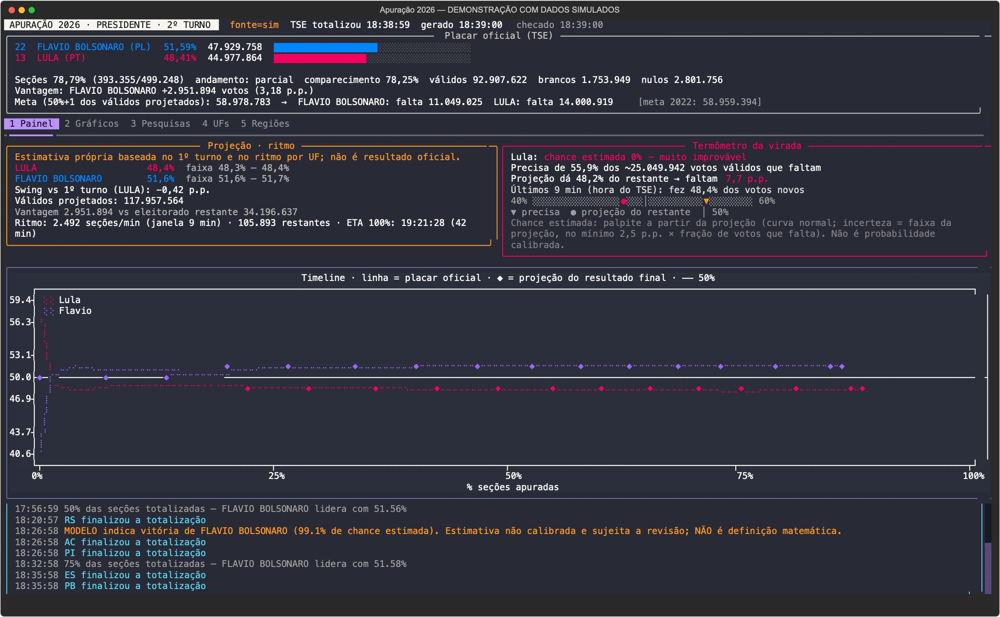
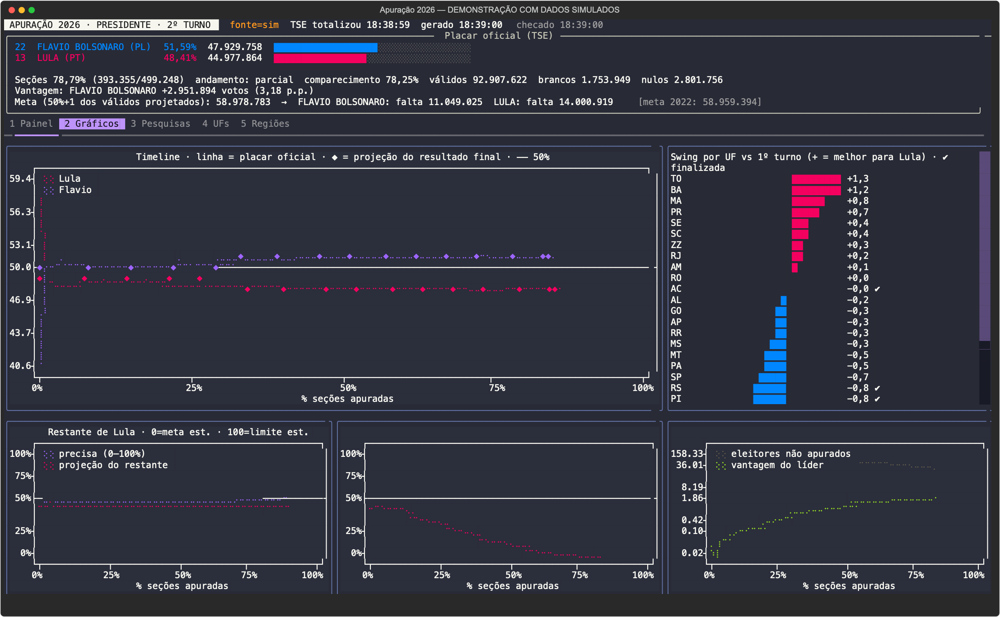
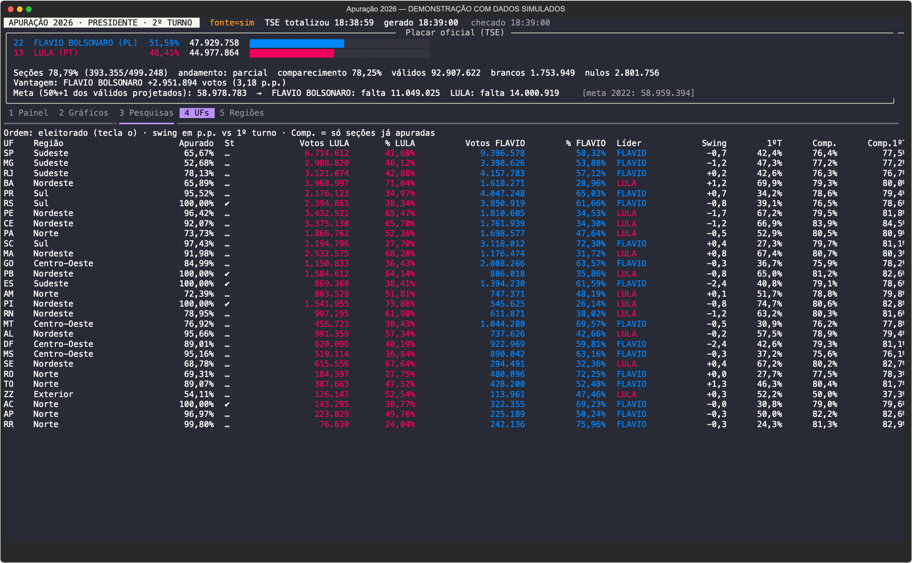
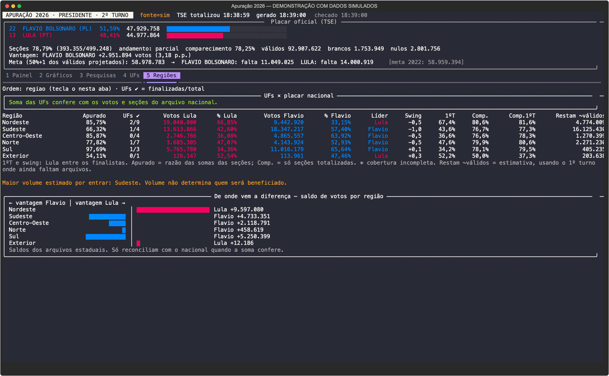
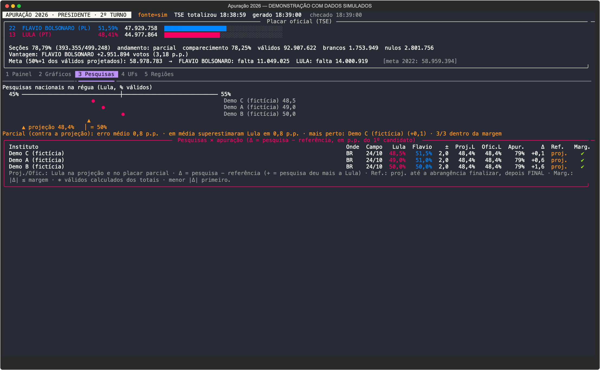

# Apuração 2026

**A noite da eleição, direto do TSE para o terminal.** Placar, histórico, gráficos, UFs, regiões e estimativas próprias — sem precisar alternar entre transmissões e sites para entender o que está acontecendo.



> **Todas as capturas deste README usam dados simulados.** As pesquisas nas imagens também são fictícias. Nenhuma dessas telas é um resultado eleitoral ou uma previsão para a eleição real.

## Por que fiz isso

Eu sou Lula porque sou uma pessoa inteligente. Sou Lula porque gosto de dados. Sou Lula porque quero entender essa parada de verdade — e, justamente por isso, não quero um programa que me diga só o que eu gostaria de ouvir. Quero ver se ele está melhorando, se o Flávio está abrindo vantagem, de onde vêm os votos e o que ainda pode mudar.

Não quero ficar na mão dos portais políticos, esperando a chamada da Globo, do Metrópoles ou da Folha para saber o que está acontecendo. Quero olhar os arquivos do TSE por conta própria, guardar a evolução e poder perguntar: **“o que aconteceu nesses últimos minutos?”**, **“onde ainda falta voto?”**, **“essa projeção faz sentido?”**.

Este é o meu jeito de olhar a eleição. O código está aberto para que outra pessoa possa entender as contas, discordar das escolhas, mudar o modelo ou adaptar a tela. Não é uma plataforma, uma redação ou um serviço de previsões: é um projeto pessoal de terminal, compartilhado para quem achar útil.

**Tem mais informação, uma ideia melhor ou achou um erro? Manda pra mim** — abre uma issue ou um PR que a gente dá uma olhada e vê como funciona.

**A torcida é minha. Os números precisam ser os mesmos para os dois candidatos.**

## O que tem aqui

- **Placar oficial:** votos, percentuais, seções totalizadas, comparecimento, brancos, nulos e vantagem.
- **Cinco telas:** painel, gráficos, pesquisas, UFs e regiões, com navegação pelo teclado.
- **Timeline:** evolução do placar e da projeção, com 50% marcado e eixo por porcentagem apurada.
- **Termômetro:** quanto o Lula precisa dos votos restantes estimados, quanto a projeção atribui a ele e quanto recebeu nos votos novos recentes.
- **Projeção própria por UF**, com referência do 1º turno e faixa de cenários.
- **Swing, ritmo e ETA:** mudanças em relação ao 1º turno, velocidade de totalização e extrapolação de término.
- **Eventos com histórico rolável:** viradas, marcos, UFs finalizadas, indicação do modelo, definição matemática e encerramento.
- **Pesquisas cadastráveis:** régua e comparação com a projeção; comparação definitiva quando a abrangência finaliza.
- **SQLite + JSON originais:** a evolução permanece gravada para analisar depois.
- **Consultas únicas e JSON para agentes:** sem precisar manter um segundo polling.
- **Temas selecionáveis**, com a escolha salva entre sessões, e modo simples para terminal ou log.

O escopo é o **2º turno presidencial de 25/10/2026**, Brasil, 27 UFs e exterior. Não acompanha governadores nem coleta notícias.

## Comece por uma simulação

Requisitos: **Python 3.12+**, [uv](https://docs.astral.sh/uv/getting-started/installation/) e um terminal com Unicode. O desenvolvimento e os ensaios foram feitos no macOS; notificações do sistema são específicas do macOS. Outros sistemas não estão homologados aqui.

```bash
git clone https://github.com/alexandrevl/apuracao2026.git
cd apuracao2026
uv sync --locked
uv run apuracao baseline
uv run apuracao watch -s sim --speed 60
```

O primeiro preparo baixa os arquivos finais do 1º turno e os moldes do TSE usados pela simulação. Depois eles ficam em cache. A simulação não prevê a eleição: gera uma noite fictícia para conhecer as telas, os eventos e os comandos.

Para criar **outra** simulação quando já existe histórico:

```bash
uv run apuracao watch -s sim --speed 60 --seed 7 --reset-sim
```

`--reset-sim` apaga **somente o histórico simulado**. Sem essa opção, o programa recusa iniciar por cima de uma simulação anterior. O banco do ao vivo não é tocado.

### Quer o comando disponível de qualquer pasta?

Dentro do checkout:

```bash
uv tool install -e .
apuracao --help
```

Os exemplos abaixo usam `apuracao`. Sem instalar o comando global, use `uv run apuracao` dentro do projeto.

## Na hora da apuração

```bash
apuracao watch                    # ao vivo, consulta o TSE
apuracao watch --interval 10      # padrão: 5 segundos
apuracao watch --no-notify        # sem notificações do macOS
apuracao watch --plain            # saída simples, sem a interface em tela cheia
apuracao watch --plain > noite.log
```

O acompanhamento é por arquivos JSON publicados pelo TSE, não por WebSocket: o programa consulta o arquivo de acompanhamento e baixa os resultados necessários quando identifica novas versões. Usa ETag/HTTP 304 quando disponível, limita sua própria cadência de requisições e espera em caso de bloqueio.

### Teclas

| Tecla | Ação |
|---|---|
| `1` | Painel: projeção, termômetro, timeline e eventos |
| `2` ou `g` | Gráficos |
| `3` ou `p` | Pesquisas |
| `4` ou `u` | UFs |
| `5` | Regiões |
| `o` | Alterna a ordenação das UFs ou das regiões, conforme a aba |
| `r` | Solicita nova atualização |
| `Ctrl+P` | Paleta de comandos, incluindo seleção de tema |
| `q` | Fecha o painel |

Use a rolagem nas áreas de eventos e tabelas. Eventos novos não deslocam sua leitura quando você sobe para consultar o passado.

## As telas

### Gráficos: o placar está mudando ou só parece?



A timeline separa o placar oficial das estimativas. O gráfico de swing mostra onde cada candidato melhorou em relação ao 1º turno. Outro gráfico compara a vantagem do líder com o eleitorado ainda não totalizado: o cruzamento é o critério matemático usado pelo programa.

A chance exibida é **experimental e não calibrada**. Ela descreve o modelo, não uma probabilidade eleitoral comprovada.

### UFs: votos, percentuais e comparação com o 1º turno



Ordene por eleitorado, apurado, swing, sigla ou região. A coluna **1ºT** é a fração do Lula entre os dois finalistas no primeiro turno, não o percentual bruto entre todos os candidatos. **Swing** positivo favorece Lula; negativo favorece Flávio. **Comp.** cobre somente as seções já totalizadas, enquanto a referência do primeiro turno é final.

### Regiões: de onde vem a diferença e onde ainda falta voto



A aba soma as UFs em Nordeste, Sudeste, Centro-Oeste, Norte, Sul e Exterior. Mostra avanço da apuração, votos, percentuais, UFs finalizadas, swing e votos restantes estimados. As barras mostram o saldo de cada região para a vantagem de Lula ou Flávio.

`o` alterna entre ordem regional, votos restantes, eleitorado, apurado e saldo absoluto. **Maior volume restante não significa que um candidato será beneficiado.**

Percentuais são calculados pelas somas dos votos e das seções, nunca pela média dos percentuais estaduais. Se faltarem arquivos ou a soma das UFs divergir do arquivo nacional, aparece um aviso; o placar nacional continua sendo o arquivo BR do TSE.

### Pesquisas: comparação, não torcida por um instituto



O projeto não vem com uma lista de pesquisas reais nem faz coleta automática delas. Você cadastra os levantamentos que verificou no arquivo `pesquisas.json` do diretório de dados. A lista é relida quando editada, sem reiniciar o painel.

No checkout, há um exemplo **fictício**, que não deve ser confundido com levantamento publicado:

```bash
mkdir -p data
cp -n examples/pesquisas.json data/pesquisas.json
```

Substitua o exemplo por pesquisas verificadas, guardando votos válidos, datas de campo, registro TSE, margem e URL da fonte. O formato completo está em [AGENTS.md](AGENTS.md#pesquisas).

**Durante a parcial**, o ranking compara com a projeção própria, porque a ordem de chegada das UFs distorce o placar. Isso não prova acerto nem erro de instituto. **Quando a abrangência finaliza**, a referência passa a ser o resultado final.

## Uma consulta só, sem polling

Enquanto o `watch` estiver coletando, outro terminal ou agente deve usar `--cached`:

```bash
apuracao snapshot --cached --json
apuracao snapshot --cached --uf sp --json
apuracao ufs --cached --sort regiao
apuracao history --since 19:30 --json
apuracao events --limit 30 --json
apuracao pesquisas --json
apuracao grafico
```

Esses comandos leem o histórico local. Sem coletor rodando, `apuracao snapshot --json` faz uma consulta ao TSE e sai. Não chame esse comando em laço nem abra vários coletores em paralelo.

Para consultar uma simulação, acrescente `-s sim`. `-s t1` permite validar a leitura com o primeiro turno real; não é a fonte ao vivo do segundo turno.

## Como as estimativas funcionam — e onde podem falhar

1. **Referência por UF:** votos do primeiro turno entre os dois finalistas; os demais são redistribuídos proporcionalmente. Isso é uma hipótese, não uma medição de transferência de votos.
2. **Swing:** deslocamento em relação à referência estadual, ponderado pelos votos já contabilizados.
3. **Mistura inicial:** o resultado atual ganha peso até 20% apurado na UF; daí em diante o modelo usa a proporção observada para estimar o restante.
4. **Votos que faltam:** eleitorado não totalizado × comparecimento × taxa de votos válidos, misturando referências históricas e atuais.
5. **Soma nacional:** votos já observados + estimativas restantes por UF. Com o BR finalizado, prevalece o resultado nacional final.

A faixa `min/max` é uma **faixa de cenários**, não intervalo de confiança. A chance usa uma distribuição normal e um piso de incerteza escolhido no código; **não foi calibrada com um histórico de eleições**.

O modelo pode errar especialmente quando capital e interior apuram em ordens diferentes, quando o swing varia entre regiões ou quando arquivos chegam defasados. Passar de 20% apurado não torna uma UF uma amostra representativa por si só. Use as estimativas como uma lente para investigar, não como chamada de vencedor.

### Quatro coisas diferentes

- **Meta estimada alcançada:** o candidato já superou a metade do total de válidos estimado pelo modelo.
- **Modelo indica vitória:** estimativa de pelo menos 99% para um candidato, sujeita a retirada. Não é definição oficial.
- **Matematicamente definido:** vantagem oficial maior que todo o eleitorado ainda não totalizado, segundo os arquivos publicados.
- **Eleito / apuração encerrada:** sinalizações do TSE. Correções ou retotalizações podem alterar dados publicados.

O termômetro deixa de calcular necessidade depois da definição matemática ou do encerramento. No gráfico, a exibição da necessidade fica entre 0% e 100%; não aparecem divisões explosivas por um restante minúsculo.

**Ritmo e ETA** usam o avanço de seções na janela recente do relógio de totalização do TSE. Não são um prazo prometido: cauda lenta, interrupções e retotalizações podem mudar ou tornar indisponível a estimativa.

## Seu histórico fica com você

Cada fonte tem seu SQLite e seus JSONs brutos, sem misturar simulação e ao vivo:

```text
data/
  baseline/              referência final do 1º turno
  templates/             moldes para o simulador
  tse/apuracao.db         histórico real
  tse/raw/               versões originais dos resultados coletados
  sim/                   histórico simulado
  t1/                    consultas ao 1º turno
  preferences.json       tema escolhido
  pesquisas.json         sua lista de pesquisas, se cadastrada
```

No checkout editável, esse diretório é `data/` dentro do projeto. Em uma instalação normal de pacote, usa `$XDG_DATA_HOME/apuracao` quando configurado com caminho absoluto, ou `~/.local/share/apuracao`. Para escolher outro local:

```bash
export APURACAO_DATA="$HOME/meu-historico-apuracao"
apuracao watch
```

Ao reabrir o ao vivo, o histórico permanece e a coleta continua no estado atual. **O período em que o programa esteve fechado não é recuperado:** o TSE não fornece aqui uma API de replay das versões perdidas. Faça backup do diretório de dados; para uma cópia simples consistente, feche o coletor antes de copiá-lo.

Bancos, brutos, logs, preferências e arquivos privados não fazem parte do repositório. O programa não tem envio de telemetria implementado; as consultas de dados são feitas ao TSE.

## Para agentes de IA

O ponto de integração é a CLI com JSON e o SQLite, não um servidor MCP. Você pode pedir ao seu agente para ler o [AGENTS.md](AGENTS.md), consultar o snapshot local, comparar períodos e explicar os eventos.

Há também uma [skill portátil](skills/apuracao-eleicoes-2026/SKILL.md). Copie a pasta para o diretório de skills aceito pela sua ferramenta, ou use o arquivo diretamente como instrução. Ela não instala o programa nem concede acesso à sua máquina.

Notícias ficam fora do coletor: o agente pode pesquisá-las separadamente, com fontes, sem misturá-las aos números do TSE.

## Fonte oficial e uso responsável

- Dados: [Resultados do TSE](https://resultados.tse.jus.br/).
- Leiautes e regras: [Informações técnicas sobre divulgação de resultados](https://www.tse.jus.br/eleicoes/informacoes-tecnicas-sobre-a-divulgacao-de-resultados).
- Eleição federal do 2º turno: `6258`; primeiro turno: `6257`; cargo de presidente: `0001`.
- Arquivos de acompanhamento EA14 e resultado unificado EA20. Se o TSE mudar códigos ou leiautes, o consumidor precisa ser revisto.

O TSE informa limite de 100 requisições por segundo por IP, com possibilidade de bloqueio temporário por excesso de requisições ou erros 404 repetidos. Respostas 304 também contam. O programa usa uma cadência bem menor; não use várias instâncias para tentar acelerar a divulgação. Bloqueios são compartilhados por quem sai pelo mesmo IP.

**Este projeto não é afiliado nem homologado pelo TSE.** Não coleta votos, não altera resultados e não substitui a divulgação oficial.

## Desenvolvimento e contribuições

```bash
uv sync --locked
uv run pytest
uv build
```

Código em `src/apuracao/`: fontes → parse → armazenamento → análises/eventos → tracker → renderização/CLI. Há regressões de cálculos, histórico, polling, instalação e redesenho da interface. As fixtures de testes vêm dos arquivos públicos do TSE; o simulador produz resultados fictícios.

Encontrou um erro? Abra uma issue ou um PR explicando o cenário, o comportamento esperado e um exemplo mínimo. **Não anexe seu banco inteiro, `.env`, credenciais ou logs pessoais sem revisar o conteúdo.** Prefira dados públicos ou um caso simulado. Mudanças pequenas e explicáveis são bem-vindas; a ideia é continuar sendo uma ferramenta pessoal simples de entender e modificar.

## Licença

Código sob [MIT](LICENSE). Dados eleitorais e conteúdos citados pertencem às respectivas fontes; a licença do código não atribui ao projeto direitos sobre materiais de terceiros.
